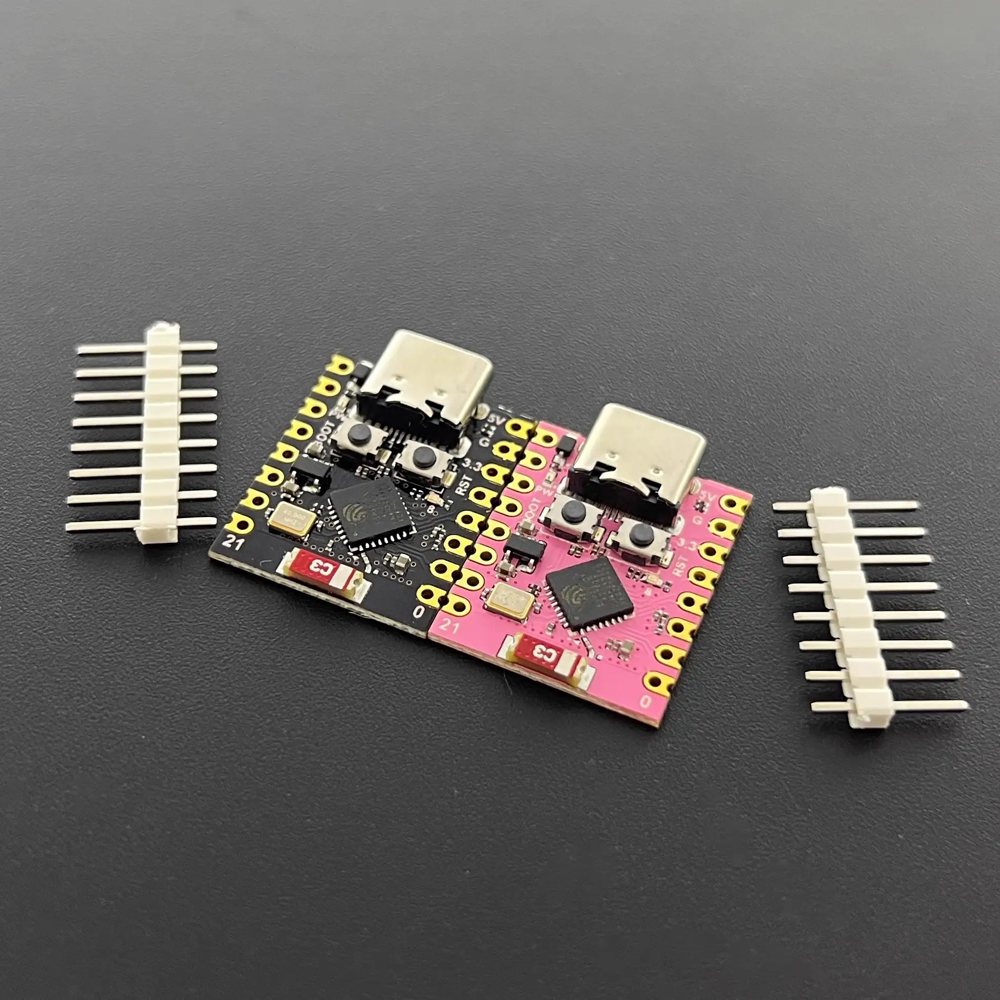
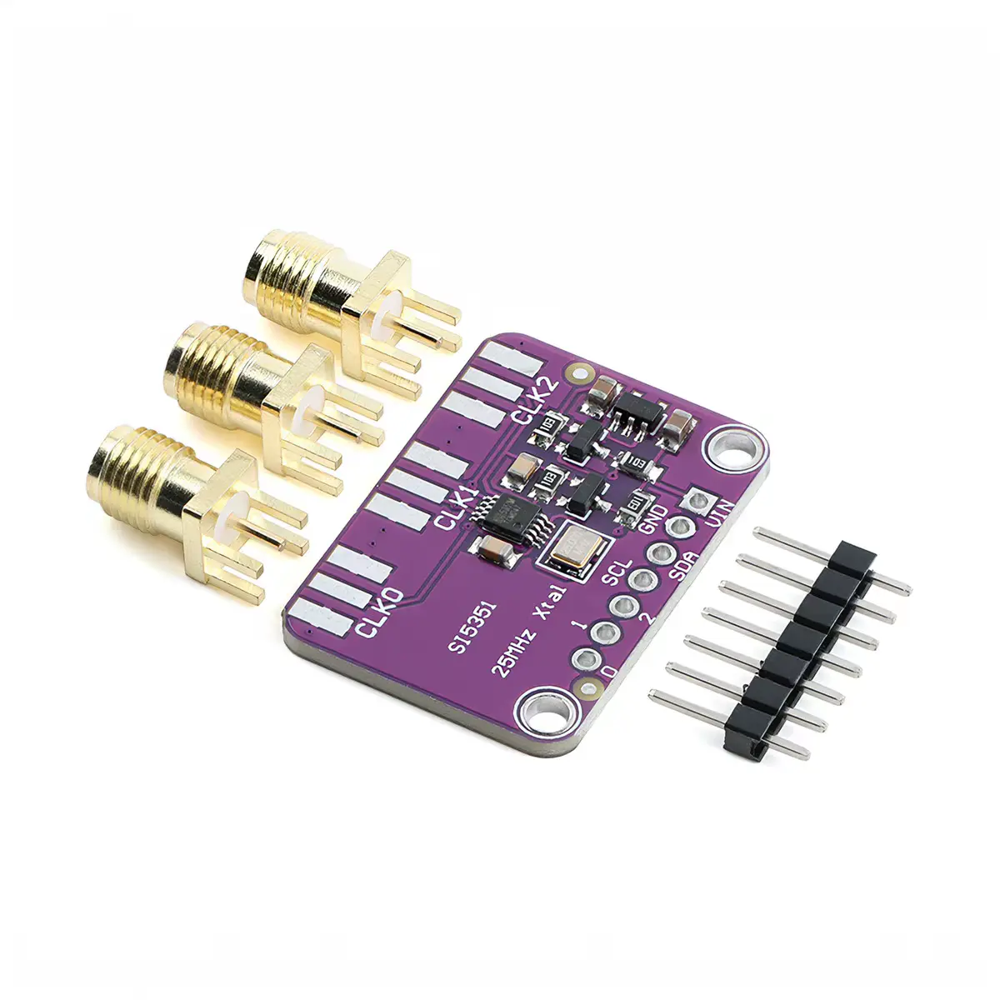
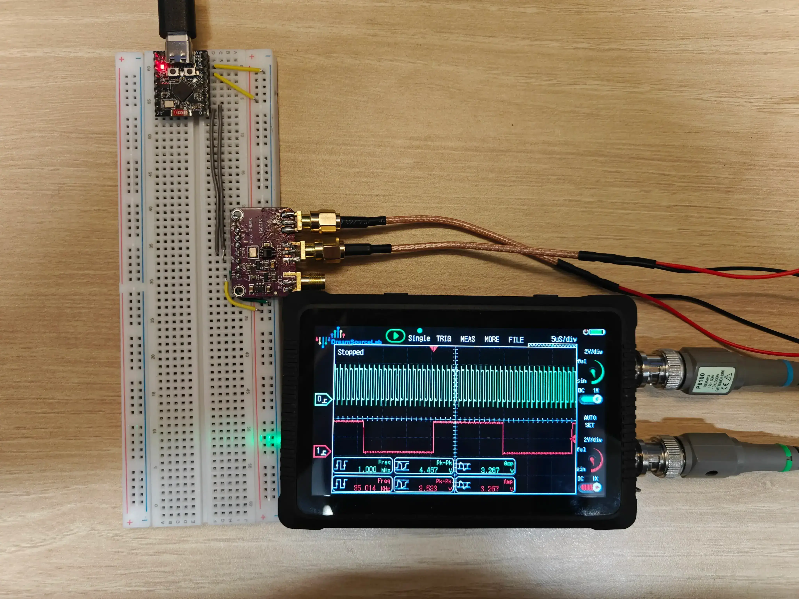
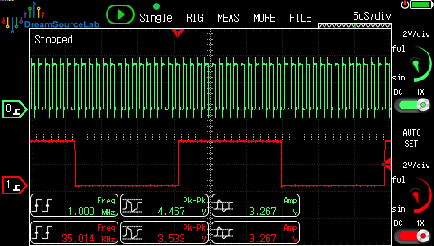
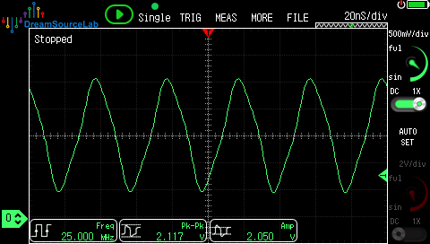

# ESP32-C3 + Si5351 Signal Generator

[简体中文](README.zh-CN.md)

## Introduction

A three-channel Si5351A clock signal generator based on ESP32-C3 (Rust / ESP-IDF). The device is controlled over **BLE** by default. It also starts an **open access point named `Si5351-FG`**; open http://192.168.23.1/ in a browser to control it through the web interface. Router Wi-Fi credentials can also be provisioned, allowing the device to connect in AP+STA mode.

<table>
  <tr>
    <td align="center" valign="middle" width="200">
      
        <a href="https://www.nologo.tech/product/esp32/esp32c3/esp32c3supermini/esp32C3SuperMini.html"><small>ESP32C3-SuperMini 4MB</small></a>
    </td>
    <td align="center" valign="middle" width="200">
      
        <a href="https://e.tb.cn/h.j4qThQqLoWK24KT?tk=BE5mTzXoozT"><small>Taobao Si5351 clock generator module</small></a>
    </td>
  </tr>
</table>

### Results

<table>
  <tr>
    <td align="center" valign="middle" rowspan="2">
      <br/>
      <small>Test equipment: DS4T252</small>
    </td>
    <td align="center" valign="middle">
      
    </td>
  </tr>
  <tr>
    <td align="center" valign="middle">
      
    </td>
  </tr>
</table>

## Features

- Three independent outputs (CLK0 / CLK1 / CLK2), with a frequency range of **7.813 kHz–160 MHz** and per-channel enable control.
- Single-channel frequency sweep with configurable start/end frequency, step, dwell time, and loop mode. Sweeps can be started and stopped over BLE or HTTP.
- Selectable output drive strength: 2 / 4 / 6 / 8 mA.
- BLE is enabled by default. The device name is `Si5351-FG`; no button or serial connection is required for control.
- An open SoftAP is enabled by default: SSID `Si5351-FG`, IP **192.168.23.1**, with the HTTP control page available immediately.
- Router SSID/password can be provisioned over BLE or from the AP web page. The device connects in AP+STA mode while keeping its access point available.
- Wi-Fi credentials and settings can be stored in NVS and restored automatically at boot.
- BLE and Wi-Fi work simultaneously; BLE remains available while AP/STA is running.

## Hardware Wiring

Only I2C and power connections are required between the ESP32-C3 and Si5351:

| ESP32-C3 | Si5351 module | Description |
| --- | --- | --- |
| `3V3` | `VIN` | 3.3 V |
| `GND` | `GND` | Common ground, required |
| `GPIO1` | `SDA` | I2C data |
| `GPIO0` | `SCL` | I2C clock |
|  | `CLK0` / `CLK1` / `CLK2` | Clock outputs |

> The current firmware uses **SDA = GPIO1 and SCL = GPIO0**. GPIO0/1 are also ADC / XTAL_32K pins, but the GPIO matrix allows them to be used for I2C. They also avoid the strapping pins (GPIO2/8/9) and USB-Serial-JTAG pins (GPIO18/19). If the development board has a 32.768 kHz crystal connected to GPIO0/1, use GPIO4/5 instead.
>
> To change the pins, update `peripherals.pins.gpio1/gpio0` in `src/main.rs` and update `I2C_SDA_GPIO` / `I2C_SCL_GPIO` in `src/config.rs` for logging. GPIO4/5 are common alternatives.

## Build and Flash

### Requirements

- Rust nightly (the project uses `build-std`; see `rust-toolchain.toml`).
- `espflash` (configured as the Cargo runner): `cargo install espflash`
- On the first build, `embuild` automatically prepares ESP-IDF v6.1 (`ESP_IDF_TOOLS_INSTALL_DIR=global`, installed under `~/.espressif`).
- An ESP32-C3 development board with 4 MB flash is recommended (see the partition notes below).

### Commands

```bash
cargo build --release
cargo run --release    # Build, flash, and run
```

Or flash manually:

```bash
espflash flash --monitor \
  target/riscv32imc-esp-espidf/release/espc3-si5351-fg
```

### Configuration Notes

The following options are enabled in `sdkconfig.defaults`:

- NimBLE (BLE only; Bluedroid, Central, Observer, and Broadcaster are disabled, leaving Peripheral + GATT Server).
- Wi-Fi and BLE software coexistence.
- 4 MB flash with a 1.5 MB application partition.
- HTTP server request-header limit of 1024 bytes.

For a board with only 2 MB flash, change `CONFIG_ESPTOOLPY_FLASHSIZE_4MB=y` to the corresponding capacity and use a smaller partition table. The firmware may not fit; 4 MB or more is recommended.

## BLE Control

The device advertises as `Si5351-FG` (the web page filters by this prefix).

### GATT Service

Service UUID: `53510000-0001-4a5b-8c9d-e0f123456789`

| Characteristic | UUID | Properties | Value format |
| --- | --- | --- | --- |
| Command | `53510000-0002-4a5b-8c9d-e0f123456789` | Write / WriteNoRsp | ASCII command line, terminated by `\n` |
| Response | `53510000-0003-4a5b-8c9d-e0f123456789` | Read / Indicate | Most recent response |
| CLK0 state | `53510000-0004-4a5b-8c9d-e0f123456789` | Read | `freq_hz,enabled,drive_ma` |
| CLK1 state | `53510000-0005-4a5b-8c9d-e0f123456789` | Read | Same as above |
| CLK2 state | `53510000-0006-4a5b-8c9d-e0f123456789` | Read | Same as above |
| Wi-Fi state | `53510000-0007-4a5b-8c9d-e0f123456789` | Read | `state,ip,reason` (`state`: 0 unconfigured, 1 connecting, 2 connected, 3 failed, 4 AP mode; `reason` is the ESP-IDF disconnect reason code, or 0 for none) |
| Info | `53510000-0008-4a5b-8c9d-e0f123456789` | Read | `version,uptime_seconds,si_ok` (`si_ok`: 1 means Si5351 communication is working) |
| Sweep state | `53510000-0009-4a5b-8c9d-e0f123456789` | Read | `running,channel,current_hz` |

The Command characteristic may be written in multiple MTU-sized fragments. The firmware buffers fragments and executes the command after receiving a newline. A single command must not exceed 1024 bytes.

### Command Protocol

| Command | Description | Response |
| --- | --- | --- |
| `PING` | Connectivity test | `OK PONG` |
| `SET <ch> <freq_hz> [<on> <ma>]` | Set frequency; optionally set output state and drive strength | `OK S<ch> <freq_hz>` |
| `ON <ch>` / `OFF <ch>` | Enable / disable output | `OK O<ch> <0\|1>` |
| `DRIVE <ch> <ma>` | Set drive current (2/4/6/8) | `OK D<ch> <ma>` |
| `SAVE` | Save current channel settings to NVS | `OK SAVE` |
| `RESET` | Restore default channel settings | `OK RESET` |
| `WIFI <ssid_hex> <pass_hex\|->` | Set Wi-Fi; SSID/password are UTF-8 encoded as hexadecimal, and `-` means an empty password | `OK WIFI`, followed by `WIFI...` → `OK <ip>` or `ERR WIFI` |
| `FORGET` (or `WIFI CLEAR`) | Delete saved router credentials and return to the default AP mode | `OK FORGET` |
| `SWEEP <ch> <start> <end> <step> <dwell_ms> [<loop>]` | Start a sweep; frequency/step are in Hz, `loop=1` enables looping | `OK SWEEP` or `ERR SWEEP` |
| `SWEEP STOP` | Stop the sweep | `OK STOP` |
| `STATUS` | Refresh status | `OK` (read the CLKx / Wi-Fi characteristics for details) |

`<ch>` is 0, 1, or 2. Example:

```
SET 0 10000000 1 8
ON 1
DRIVE 2 4
WIFI 6d794170 70617373776f7264
SAVE
```

## Wi-Fi and HTTP

The device starts an **open access point** immediately after boot:

- SSID: `Si5351-FG`
- Address: **http://192.168.23.1/**
- The HTTP server listens on port 80. AP clients receive `192.168.23.x` addresses through DHCP.

The Wi-Fi form on the web page accepts a router SSID/password:

- The device switches to **AP+STA** mode. The AP remains available while the STA connects to the router (2.4 GHz only; ESP32-C3 does not support 5 GHz).
- After a successful connection, the STA IP can be read from the Wi-Fi state characteristic, web page, or serial log. The AP address `192.168.23.1` remains available.
- If the STA connection fails, the AP remains available so the reason can be inspected and the connection retried at `192.168.23.1`.
- The web page's “Forget Wi-Fi” action / `FORGET` deletes the router credentials from NVS and returns to AP-only mode. The old network will not be reconnected after reboot.
- The AP may briefly restart when switching or reconnecting to a router. AP and STA share the radio, so the AP channel may change with the STA. If the page disconnects, reconnect to the AP and refresh.
- The AP uses `192.168.23.0/24` by default. If the router LAN uses the same subnet, change `AP_IP` in `src/config.rs` (and the page hint) to avoid a routing conflict.

| Method and path | Description |
| --- | --- |
| `GET /` | Control page |
| `GET /api/status` | Device status JSON |
| `POST /api/channel?ch=0&freq=10000000&on=1&drive=8` | Change a channel; `freq`, `on`, and `drive` are optional |
| `POST /api/wifi?ssid=...&pass=...` | Set Wi-Fi (parameters must be URL-encoded) |
| `POST /api/wifi/forget` | Delete saved router credentials and return to AP mode |
| `POST /api/sweep?ch=0&start=1000000&end=10000000&step=100000&dwell=100&loop=0` | Start a sweep |
| `POST /api/sweep/stop` | Stop the sweep |
| `POST /api/save` | Save channel settings |
| `POST /api/reset` | Restore default channel settings |

Example `/api/status` response:

```json
{
  "fw": "v0.1.0",
  "uptime": 123,
  "ble": true,
  "si": true,
  "ch": [
    {"f": 10000000, "on": 1, "d": 8},
    {"f": 1000000, "on": 0, "d": 8},
    {"f": 1000000, "on": 0, "d": 8}
  ],
  "wifi": {"state": 2, "ip": "192.168.1.23", "ssid": "mywifi", "msg": "", "reason": 0},
  "sweep": {"running": false, "ch": 0, "current": 0}
}
```

## Web Controller

File: [`web/index.html`](web/index.html)

- **BLE mode**: open the page in Chrome / Edge, click “Connect Bluetooth”, and select `Si5351-FG`.
- **HTTP mode**: connect to the open `Si5351-FG` AP and open `http://192.168.23.1/`, or open the STA IP after the device joins a router. The page automatically uses the HTTP API.
- The page has no external dependencies, follows the system light/dark theme, and works on mobile devices.
- The interface supports Chinese / English. It selects a language from the browser preference and provides `EN` / `中文` buttons in the top-right corner. The choice is remembered; `?lang=en` or `?lang=zh` can also force a language.

Web Bluetooth requires a secure context:

- For local use, serve the page from a local static server and open `http://localhost:8000/web/index.html` (`localhost` is considered a secure context):
  ```bash
  python3 -m http.server 8000
  ```
- The page can also be hosted on any HTTPS static host.
- iOS Safari does not support Web Bluetooth; use Android Chrome or desktop Chrome/Edge.

## Frequency Range and Limitations

- Output range: **7.813 kHz–160 MHz** (with the onboard 25 MHz crystal).
- Outputs are 3.3 V CMOS square waves through SMA connectors; drive strength can be set to 2/4/6/8 mA.
- CLK0 uses PLL A, CLK1 uses PLL B, and CLK2 prefers PLL A and switches to PLL B when necessary.
- Outputs above 112.5 MHz require the PLL to use the corresponding VCO (integer divide-by-4/6 mode). If all three channels request mutually conflicting high-frequency VCOs, the device rejects the combination with `ERR SYNTH`; move one channel to another frequency or use only two high-frequency outputs.
- Frequencies below approximately 1 MHz automatically use the R divider (1–128).
- Frequency accuracy mainly depends on the 25 MHz crystal itself (the modules are typically ±20–30 ppm); divider calculation error is below 1 ppm.

## Default Settings

| Channel | Frequency | State | Drive |
| --- | --- | --- | --- |
| CLK0 | 10 MHz | Enabled | 8 mA |
| CLK1 | 1 MHz | Disabled | 8 mA |
| CLK2 | 1 MHz | Disabled | 8 mA |

## Frequency Sweep

The web page's “Sweep” section or the BLE/HTTP commands can start a single-channel sweep:

- Target channel: CLK0 / CLK1 / CLK2
- Start/end frequency and step: selectable units of Hz / kHz / MHz
- Dwell time: 20–60000 ms (timing starts when each register write begins and includes I2C reconfiguration time)
- Loop: automatically return to the start after reaching the end
- Maximum of 20,000 frequency points

The target channel is enabled automatically when a sweep starts. When the sweep finishes or is stopped, the output remains enabled at the last frequency. Manual channel controls are disabled during a sweep; stop the sweep before making changes. The actual step period is the greater of the configured dwell time and I2C reconfiguration time, so high frequencies or slow I2C may make the sweep slightly slower than configured. If a frequency point cannot be synthesized with the other channel settings, the sweep stops; see the serial log for the reason.

## Security

BLE (without pairing/PIN), HTTP (without login), and the default open `Si5351-FG` **access point** have no authentication. Any device within range of the AP can connect and control the outputs. Use the device only in a trusted environment. For untrusted deployments, add Wi-Fi password protection, HTTP authentication, or BLE pairing.

## Troubleshooting

- **I2C errors on the serial console / frequency does not change**: check `3V3` → `VIN`, `GND` → `GND`, `GPIO1` → `SDA`, and `GPIO0` → `SCL`. Confirm that the module's power indicator is on and its address is `0x60`. The firmware uses 100 kHz I2C (`I2C_BAUD_HZ` in `src/config.rs`) and enables internal pull-ups. If the module is unpowered, SDA/SCL are not pulled up and the result is `ESP_ERR_TIMEOUT` rather than NACK.
- **BLE is not visible**: BLE/Wi-Fi start even if the Si5351 is disconnected; the serial console should show `NimBLE started, advertising as Si5351-FG`. If it does not, check whether `sdkconfig.defaults` was regenerated or an old `sdkconfig` cache is being used, then run `cargo clean` and rebuild.
- **Si5351 connected after boot / hot-plugged**: the firmware retries I2C every 5 seconds and configures the device automatically without a reboot.
- **The phone cannot find BLE**: confirm that the device has started and printed `BLE advertising as Si5351-FG`. Only one BLE connection is allowed at a time (`CONFIG_BT_NIMBLE_MAX_CONNECTIONS=1`).
- **STA Wi-Fi cannot connect**: the AP remains available at `http://192.168.23.1/`. ESP32-C3 supports 2.4 GHz only; WPA2, WPA3, and mixed WPA2-WPA3 networks are supported. The page shows the ESP-IDF disconnect reason code. Common values:
  - `201`: SSID not found (confirm that a 2.4 GHz network exists and the name has no extra spaces).
  - `202` / `15` / `204`: authentication or handshake failure, usually an incorrect password.
  - `211`: AP security mode is below the required threshold (open/WEP network).
  - `212` / `200`: signal is too weak.
  - `205`: connection failed; retry.
  The password is transmitted as hexadecimal and encoded automatically by the page; leave the password empty for an open network.
- **The firmware exceeds the partition size**: the default application partition is 1.5 MB. If the linker reports overflow, use a custom 2 MB partition table or set `opt-level = "z"`.
- **The browser reports that Web Bluetooth is unavailable**: use Chrome/Edge and ensure that the page is in a secure context (localhost or HTTPS). Firefox and iOS Safari are not supported.

## Thanks to

[@adafruit/adafruit_si5351_library](https://github.com/adafruit/adafruit_si5351_library)

## License

MIT
